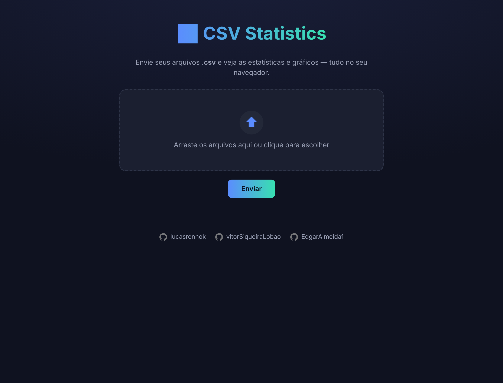
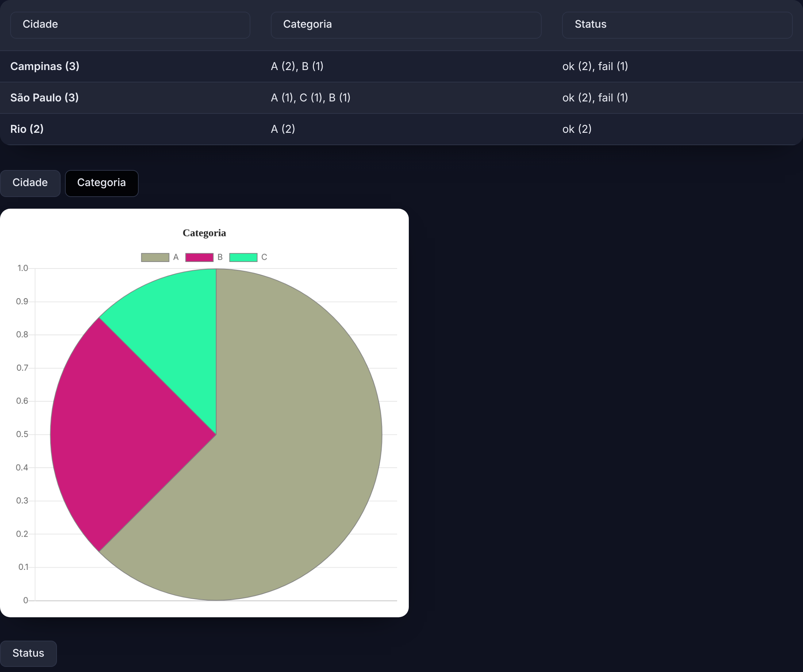

#  CSV Statistics

Site que recebe arquivos **CSV** e mostra estatísticas deles: uma tabela
agrupada e gráficos com a contagem de cada valor por coluna. Tudo roda no
navegador — nenhum arquivo é enviado para servidor.

Feito em HTML, CSS e JavaScript puros (gráficos com [Chart.js](https://www.chartjs.org/)).
Projeto antigo da faculdade, com a interface reformulada.

## :rocket: Como usar

É um site estático — não precisa instalar nada. Abra o `index.html` no
navegador (ou publique com GitHub Pages).

1. Arraste um ou mais arquivos `.csv` para a área de upload (ou clique para
   escolher).
2. Clique em **Enviar**.
3. Veja a tabela agrupada, clique nos nomes das colunas para trocar o
   agrupamento e nos botões para abrir os gráficos.

## :arrow_forward: Entrada

Um ou mais arquivos `.csv` **compatíveis** — ou seja, com as **mesmas colunas**
(mesmos nomes e mesma quantidade). Se os arquivos não forem compatíveis, ou não
forem CSV, o site avisa com um alerta.

## :arrow_backward: Saída

- Uma **tabela** agrupada por coluna, reorganizável clicando nos nomes das
  colunas.
- **Gráficos** por coluna (pizza, barra ou linha, conforme a quantidade de
  valores), mostrando quantas vezes cada item aparece. O número entre
  parênteses é a contagem.

> Dica: dá para "baixar" o resultado imprimindo a página como PDF (Ctrl+P).

## :busts_in_silhouette: Autores

- [lucasrennok](https://github.com/lucasrennok)
- [vitorSiqueiraLobao](https://github.com/vitorSiqueiraLobao)
- [EdgarAlmeida1](https://github.com/EdgarAlmeida1)
